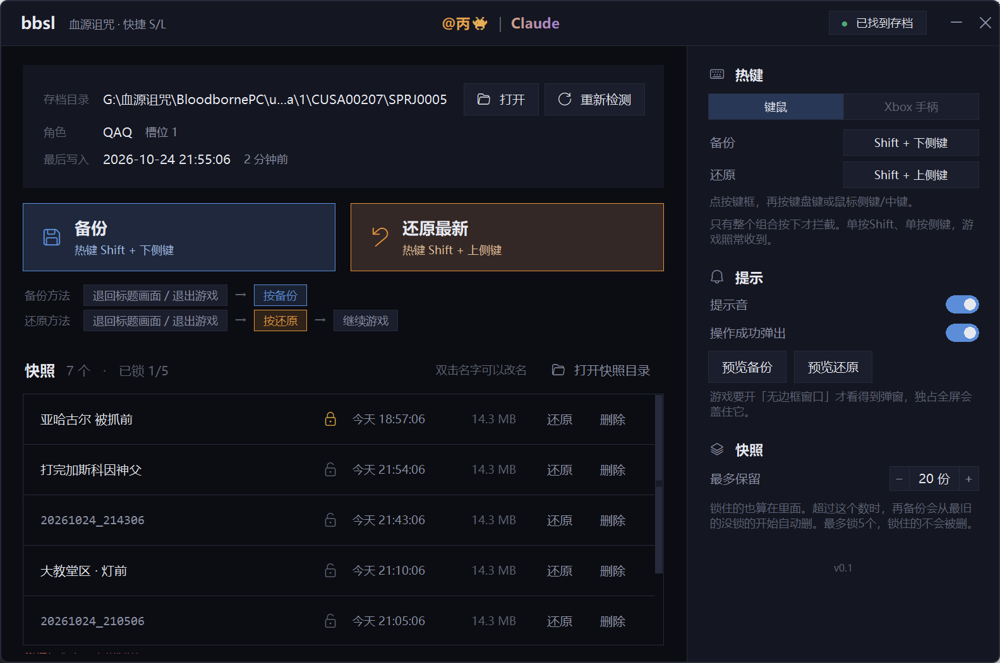

# bbsl

《血源诅咒》Windows 版的快捷 S/L 工具。按一下热键备份存档，再按一下还原，键鼠和 Xbox 手柄都能用。

bbsl 是一个独立的小工具，只做一件事：复制游戏目录下 `user\savedata` 里的存档文件。它不改游戏、不改启动器，也不依赖任何其他项目。



## 下载

到 [Releases](../../releases) 下载最新的 `bbsl-vX.X.zip`，免安装，解压就能用。

**只支持 Windows 10 / 11。** bbsl 用到了很多 Windows 专属的系统接口（全局热键、手柄、窗口外观），macOS 和 Linux 上跑不起来，也没测过。

## 用法

1. 把解压出来的 `bbsl` 文件夹**整个**放进游戏目录（就是 `Bloodborne.exe` 所在的那个文件夹）
2. 打开 `bbsl\bbsl.exe`，右上角显示 **已找到存档** 就可以了
3. 玩的时候让 bbsl **开着**（最小化就行），关掉窗口热键就停了

```
游戏目录\
├─ Bloodborne.exe
├─ user\savedata\         ← 游戏存档，bbsl 会自己找到它
└─ bbsl\
   ├─ bbsl.exe
   ├─ _internal\           ← bbsl 运行要用的文件，别删别挪
   ├─ bbsl_config.json     ← 你的设置（改过设置才会出现）
   └─ bbsl_backups\        ← 你的备份都在这里
      └─ 20261024_183012\
         ├─ meta.json      ← 名字、时间、锁没锁
         └─ savedata\      ← 原样复制的存档
```

bbsl 只能开一个，再打开一次只会把已经开着的那个叫到前面来。

### 备份和还原的正确姿势

**先退回标题画面（或者直接退出游戏），再按热键，然后继续游戏。** 备份和还原都一样，在游戏外按。

在游戏里直接还原，游戏下一次自动存档会把还原的内容盖掉，等于没还原。

比如打 Boss：

> Boss 门口退出游戏 → 按备份 → 进游戏打 → 死了退出游戏 → 按还原 → 再进游戏

### 默认热键

|        | 键鼠                | Xbox 手柄                   |
|--------|---------------------|-----------------------------|
| 备份   | `Shift` + 下侧键    | `LB` + `Back`，按住 0.6 秒  |
| 还原   | `Shift` + 上侧键    | `RB` + `Start`，按住 0.6 秒 |

- 下侧键是鼠标上的"后退"键，上侧键是"前进"键。鼠标没有侧键的话，换成键盘键就行
- 在界面右边点一下按键框就能改：键盘键、鼠标侧键、中键都行，可以先按住 `Ctrl` / `Shift` / `Alt`；按 `Esc` 取消
- 只有**整个组合**按下时才会被拦截，单按 `Shift` 或单按侧键，游戏照常收到
- 手柄组合至少两个键，按住 0.6 秒才触发，多按了别的键不算，免得和游戏操作撞上

**键鼠和手柄二选一**，没选中的那套完全不生效：

- 没插手柄：只能用键鼠
- 插上 Xbox 手柄：自动切到手柄
- 插着手柄也想用键鼠：在右边「热键」那里点一下「键鼠」，之后就不会再自动切过去；想恢复，点一下「Xbox 手柄」

### 快照

- **还原热键**还原的是时间最新的那份；想回到更早的，在列表里点那一行的「还原」
- 还原就是直接用快照覆盖当前存档，不会另外再存一份
- 快照默认最多留 **20 份**，锁住的也算在里面（右边可以调）。超了以后再备份，从最旧的**没锁的**开始自动删
- **锁**：点一下那一行的锁图标就锁住，再点解锁，最多锁 **5 个**。锁住的不会被自动删，在列表里置顶；但不影响还原热键，还原热键照样还原时间最新的那份
- 存档没变的时候连按备份，不会多出一份一样的，只会把上一份的时间刷新一下（改过名的、锁住的除外）
- 双击快照名字可以直接改名，回车保存，`Esc` 取消

## 提示音和弹窗

按热键备份或还原后会有提示音，屏幕上方还会弹出一个小窗；失败了也会弹，告诉你原因。右边「提示」里可以分别关掉，也可以点「预览」先看看效果。

- 弹窗只有游戏用**无边框窗口**模式时才看得到，独占全屏会把它盖住
- 想换提示音：在 `bbsl.exe` 旁边建一个 `sounds` 文件夹，放 `save.wav` / `load.wav` / `error.wav`，放了哪个就用哪个

## 常见问题

**显示"没找到存档"**
确认 `bbsl` 文件夹在游戏目录里面。bbsl 会从自己所在的位置往上找 `user\savedata`，最多找三层。

**在游戏里按热键没反应**
- 确认 bbsl 开着，而且右边选的是你正在用的那套（键鼠 / 手柄）
- 游戏要是以管理员身份运行，bbsl 也得以管理员身份运行，反过来也一样，不然 Windows 不让 bbsl 收到游戏窗口里的按键

**还原提示"存档文件被占用"**
游戏正在用存档文件。退回标题画面或者退出游戏再按。这种情况下 bbsl 什么都不会改，不会只还原一半。

**杀毒软件报毒**
bbsl 要在后台监听键盘鼠标才能实现全局热键，又是用 PyInstaller 打包的，这两点都容易被误报。代码全在这里，不放心可以自己从源码运行或者打包。

**PS 手柄能用吗**
暂时不直接支持。用 Steam 输入或 DS4Windows 把它模拟成 Xbox 手柄的话可以用，不过没测过。

**备份很占地方？**
每份大约 14 MB，因为存档里 10 个角色槽位不管有没有用都会原样复制。默认最多 20 份，也就是不到 300 MB；嫌多可以在右边把上限调小。

**`_internal` 文件夹是什么**
bbsl 运行要用的 Python 环境。玩家电脑上一般没装 Python，所以打包时把 Python 本体、界面库（tkinter）、微软的 C 运行库和图标一起放进来了。`bbsl.exe` 只是个启动器，真正干活要靠它。

`bbsl.exe` 和 `_internal` **必须放在一起**，删掉或者挪走 `_internal`，bbsl 就打不开了。整个 `bbsl` 文件夹一起拷就行，不用管里面是什么。

**怎么升级到新版本**
把旧 `bbsl` 文件夹里的 `bbsl_backups` 和 `bbsl_config.json` 复制到新版本的 `bbsl` 文件夹里，再删掉旧的。

**怎么删掉 bbsl**
直接删掉 `bbsl` 文件夹。**备份也在里面**，有想留的先拷出来。bbsl 除了在系统临时文件夹里放几个提示音文件（`%TEMP%\bbsl_sounds`），不往别的地方写东西，也不改注册表。

## 从源码运行

需要 Windows 10 / 11 和 Python 3（开发用的是 3.14），不需要装别的库。

```
python src\main.py            正常运行
python src\main.py --demo     用假数据看界面，不碰任何存档
```

打包成免安装版需要先装 PyInstaller，打好的东西在 `dist` 里：

```
pip install pyinstaller
python build.py
```

`build.py` 会把 `README.md` 和给玩家看的精简版 `docs/README.txt` 一起放进 `dist\bbsl\`。

## 技术架构

**纯 Python，只用标准库**，没有任何第三方依赖（PyInstaller 只在打包时用）。界面和逻辑在同一个进程里，界面直接调函数，没有前后端之间的网络接口。

| 部分 | 用的是什么 |
|---|---|
| 界面 | `tkinter`，所有控件自己画（深色主题、按钮、开关、弹窗），不用系统默认样式 |
| 窗口外观 | `ctypes` 调 Win32 改窗口样式：去掉系统标题栏、固定大小、Win11 圆角；最小化和关闭按钮画在顶栏里，拖动由 tkinter 自己挪窗口 |
| 键鼠热键 | `ctypes` 装低级键盘钩子 + 低级鼠标钩子（`WH_KEYBOARD_LL` / `WH_MOUSE_LL`），只在整个组合对上时吃掉那一下按键，其余原样放行 |
| 手柄 | `ctypes` 调 XInput（`xinput1_4.dll`），60 Hz 轮询，没插的手柄位每秒才查一次 |
| 游戏内弹窗 | 一个置顶、不抢焦点、鼠标穿透的 tkinter 小窗口 |
| 提示音 | 启动时用 `wave` 现场合成三个短音效，`winsound` 异步播放 |
| 存档读写 | `os` / `shutil` / `hashlib` / `json` |

**线程**：钩子和手柄各跑一个后台线程，只往 `queue.Queue` 里塞事件；tkinter 主线程每 30 毫秒取一次再处理，因为 tkinter 不能跨线程操作。钩子回调里只做最少的事，Windows 等不及会跳过甚至摘掉钩子。

**备份**：把游戏目录下的 `user\savedata` 整个复制到 `bbsl_backups\<时间>\savedata\`，同时算一个内容指纹（SHA-256），和名字、时间、锁一起写进旁边的 `meta.json`。备份前对比指纹，存档没变就不重复存。

**还原**：分两步，先把快照里的每个文件都写成临时文件，全部写成功了再统一换上去。动手之前还会检查游戏是不是正占着存档文件，占着就停下。这样中途出任何问题，正本都不会只被改一半。

**找存档**：从 `bbsl.exe` 所在目录往上找三层，找 `user\savedata\<用户>\<游戏编号>\SPRJ0005`。认的是 `SPRJ0005` 这个目录名，不认游戏编号，因为不同版本的血源编号不一样。

```
src\
├─ main.py          入口：单实例（互斥量）、启动热键和手柄监听
├─ keyspec.py       热键的写法（shift+mouse4 这种）和显示名，界面和后端共用
├─ backend\
│  ├─ store.py      找存档、备份、还原、锁、自动清理、设置
│  ├─ hotkeys.py    键鼠全局热键（低级键盘/鼠标钩子）
│  ├─ gamepad.py    Xbox 手柄组合键（XInput）
│  └─ stub.py       数据结构、默认设置，以及 --demo 用的假数据
└─ ui\
   ├─ app.py        主窗口
   ├─ widgets.py    自绘控件
   ├─ dialogs.py    程序内弹窗
   ├─ toast.py      游戏内弹窗
   ├─ sound.py      提示音
   └─ theme.py      配色、字体、DPI、窗口外观
```

## 关于这个项目

代码由 Anthropic 的 **Claude Opus 5.5** 编写。作者提供的是思路和基础逻辑：要做什么、热键怎么组合、备份怎么存、哪里容易误触，以及实际测试和反馈。

这本身也不是什么复杂的项目，核心就是"按键时复制一下文件夹"，剩下的都是为了用着顺手和不出错。

## 协议

Copyright (C) 2026 [m78-taro](https://github.com/m78-taro)

以 [GPL-3.0](LICENSE) 协议开源：可以随便用、随便改、随便转发，但改过之后再发布，也必须以 GPL-3.0 公开源码。

## 声明

- 这是玩家自己做的非官方工具，和 FromSoftware、索尼都没有关系
- 和任何 PC 移植、启动器项目（包括 bbport、bbhost 等）也都**没有关系**，不是它们的一部分，也没有得到它们的认可或支持。bbsl 只是读写存档文件，有问题请不要去打扰那些项目的作者
- 工具会直接读写存档文件，第一次用之前建议自己另外备份一份存档
